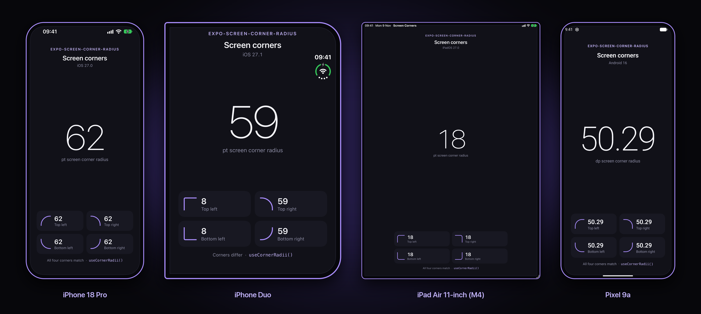
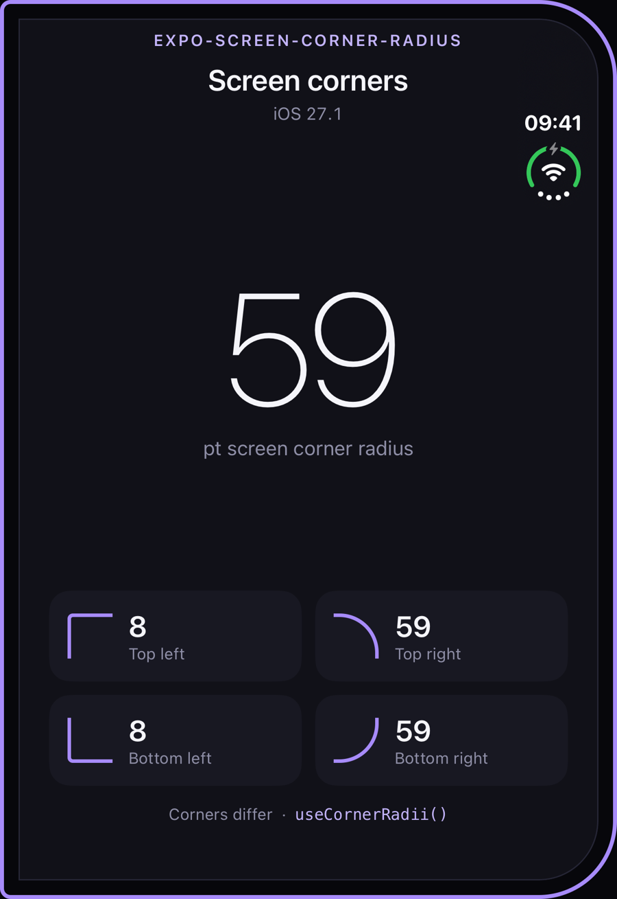

# expo-screen-corner-radius

Get the precise, native corner radius of the device screen on iOS and Android devices with rounded displays, and make your UI follow it.

<p align="center">
  
</p>

## Installation

```bash
npx expo install expo-screen-corner-radius
```

Note: **Not available** in Expo Go. Use a [development build](https://docs.expo.dev/develop/development-builds/introduction/).

## Usage

### A view that matches the screen

`<ScreenCornerView>` is a `View` whose corners follow the screen's corners. Pass `inset` when the view sits away from the edge, and each corner shrinks by that much so it stays concentric with the screen:

```jsx
import { ScreenCornerView } from "expo-screen-corner-radius";

<ScreenCornerView
    inset={12}
    fallbackRadius={24}
    style={{ position: "absolute", top: 12, left: 12, right: 12, bottom: 12 }}
/>
```

### Hooks

`useCornerRadius()` and `useCornerRadii()` return the current values and update when a foldable is folded or the device is rotated:

```jsx
import { useCornerRadius, useCornerRadii } from "expo-screen-corner-radius";

function Card() {
    const radius = useCornerRadius(); // 62 on iPhone 18 Pro
    const corners = useCornerRadii(); // { topLeft, topRight, bottomLeft, bottomRight }

    return <View style={{ borderRadius: radius ?? 0 }} />;
}
```

### Functions

Outside React, call the functions directly:

```js
import {
    getCornerRadiusSync,
    getCornerRadius,
    getCornerRadiiSync,
    getCornerRadii,
} from "expo-screen-corner-radius";

const radius = getCornerRadiusSync(); // number | null
const corners = await getCornerRadii(); // CornerRadii | null
```

## App Store Compliance

This library doesn't use any private APIs, and it complies with the App Store and Google Play guidelines.

## API Reference

All values are in points on iOS and dp on Android, the units React Native styles use.

### `useCornerRadius(): number | null`

The screen corner radius, re-read whenever `Dimensions` emits a `change` event. On devices whose corners differ, this is the largest corner.

### `useCornerRadii(): CornerRadii | null`

The radius of each corner, re-read whenever `Dimensions` emits a `change` event. Returns the same object while the values don't change, so it's safe to use in dependency arrays.

```ts
type CornerRadii = {
    topLeft: number;
    topRight: number;
    bottomLeft: number;
    bottomRight: number;
};
```

Corners are named for where they appear in your interface, so `topLeft` is always the top left of what you see, whichever way the device is turned.

### `<ScreenCornerView inset? fallbackRadius? {...ViewProps} />`

| Prop             | Default | Description                                                                                       |
| :--------------- | :------ | :------------------------------------------------------------------------------------------------ |
| `inset`          | `0`     | Distance in dp from the screen edge. Each corner shrinks by this amount, but never below `0`.    |
| `fallbackRadius` | `0`     | Radius used when the screen's corners are unknown, such as on web or before Android 12.         |

Corner styles you pass in `style` override the computed ones. On iOS, corners use `borderCurve: "continuous"` to match the display's shape.

### `getConcentricRadii(radii, inset?, fallbackRadius?): CornerRadii`

The calculation behind `<ScreenCornerView>`, for when you need the numbers yourself.

### `getCornerRadiusSync(): number | null` and `getCornerRadius(): Promise<number | null>`

The device's screen corner radius. On devices whose corners differ, such as the [iPhone Duo](#foldable-iphone-iphone-duo), it's the **largest** corner of the screen the app is on.

### `getCornerRadiiSync(): CornerRadii | null` and `getCornerRadii(): Promise<CornerRadii | null>`

The radius of each screen corner, or `null` where `getCornerRadiusSync()` would return `null`.

### Platform behavior

| Platform               | Source                                                                                     | Returns `null` when                                                                                                       |
| :--------------------- | :----------------------------------------------------------------------------------------- | :------------------------------------------------------------------------------------------------------------------------ |
| **iOS** (iPhone, iPad) | Hardware model identifier and a lookup table from [BezelKit](#data-source).                | The model is unknown and older than the newest known model. Devices without rounded corners (e.g. iPhone SE) return `0`. |
| **tvOS** and others    | —                                                                                          | Never. Always returns `0`.                                                                                                |
| **Android**            | `WindowInsets.getRoundedCorner()`, rounded to two decimal places.                          | Before Android 12, when the system doesn't report rounded corners, or before the activity's window is attached.          |
| **Web**                | —                                                                                          | Always.                                                                                                                   |

**New iPhones and iPads:** a model released after the version of this package you're using, such as `iPhone20,1`, gets the most common radius of the newest generation the package knows. Update the package to get the exact value.

## Foldable iPhone (iPhone Duo)

Apple's foldable iPhone (`iPhone19,4`, listed in Xcode as "iPhone Duo") has two screens with different corners:

<p align="center">
  
</p>

| Screen                  | Top left | Top right | Bottom left | Bottom right |
| :---------------------- | -------: | --------: | ----------: | -----------: |
| Outer, portrait         |        8 |        59 |           8 |           59 |
| Outer, landscape (left) |        8 |         8 |          59 |           59 |
| Inner, any orientation  |       55 |        55 |          55 |           55 |

On iOS, the module checks which screen the app is on by its native resolution and turns that screen's corners to match the interface orientation. `getCornerRadiusSync()` returns `59` on the outer screen and `55` on the inner screen. The hooks and `<ScreenCornerView>` update when the device is folded, unfolded or rotated.

These are the corners of the display itself. A window that doesn't reach the edge of the screen has rounder corners of its own, which this module doesn't report.

## Contributing

Contributions are welcome! If you find any inaccuracies in the corner radius values, or anything else, please open a pull request.

### Device data

`ios/CornerRadiusData.swift` is generated from [BezelKit](https://github.com/markbattistella/BezelKit). Don't edit it by hand. Fix the data upstream, then run:

```bash
npm run sync-data            # regenerate the file
npm run sync-data -- --check # exit 1 if it's out of date
```

A scheduled workflow runs the check every week, so new devices get noticed.

### Running the tests

```bash
npm test          # TypeScript wrapper, hooks and component (Jest)
swift test        # iOS lookup, screen matching and rotation (macOS, no simulator needed)

# Android helpers (JUnit), via the example app
cd example && npm install && npx expo prebuild --platform android --no-install
cd android && ./gradlew :expo-screen-corner-radius:testDebugUnitTest
```

The iOS lookup logic lives in `ios/CornerRadiusResolver.swift`. It doesn't depend on UIKit, which is why `swift test` can run it on macOS.

CI runs all three suites, lint, build and an iOS build of the example app on every push and pull request. It also checks that the committed `build/` folder is up to date.

### Example app

```bash
cd example && npm install
npx expo run:ios     # or run:android
```

### Releasing

Releases are published to npm by GitHub Actions (`.github/workflows/release.yml`), using [npm Trusted Publishing](https://docs.npmjs.com/trusted-publishers). The workflow needs no npm token, and each version gets a provenance attestation.

1. Bump the version and update `CHANGELOG.md`: `npm version minor` (or `patch` / `major`).
2. Push the commit and tag: `git push --follow-tags`.
3. Create a GitHub Release from the tag. Publishing the release runs the tests and publishes to npm. The workflow fails if the tag doesn't match the version in `package.json`.

To check a release without publishing, run the **Release** workflow manually from the Actions tab with **dry-run** ticked.

One-time setup: on npmjs.com, open the package's **Settings**, go to **Trusted Publisher**, choose GitHub Actions, and enter repository `damix00/expo-screen-corner-radius` and workflow `release.yml`.

## Data Source

The corner radius values for iOS come from the community-maintained data in the open-source [BezelKit](https://github.com/markbattistella/BezelKit) repository. That includes the per-screen corners of the iPhone Duo. The logic for matching screens and rotating corners is ported from it.
